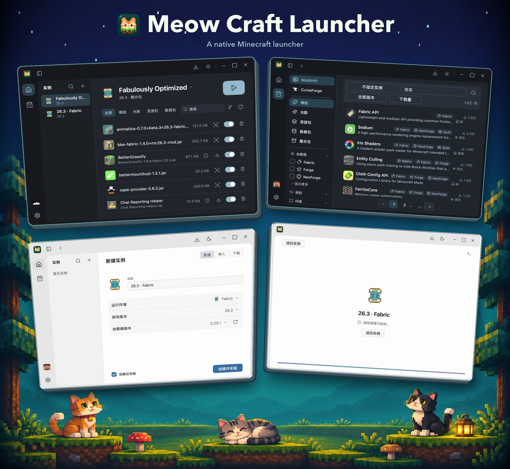

# Meow Craft Launcher

English · [简体中文](README.zh-CN.md)



**mcl** is a native Minecraft Java Edition launcher built with Go and MyGo. Create isolated instances, browse mods and resource packs, and manage Java runtimes from one app.

## Development

Requires Go 1.27.3 or later.

```sh
go tool mygo dev
```
