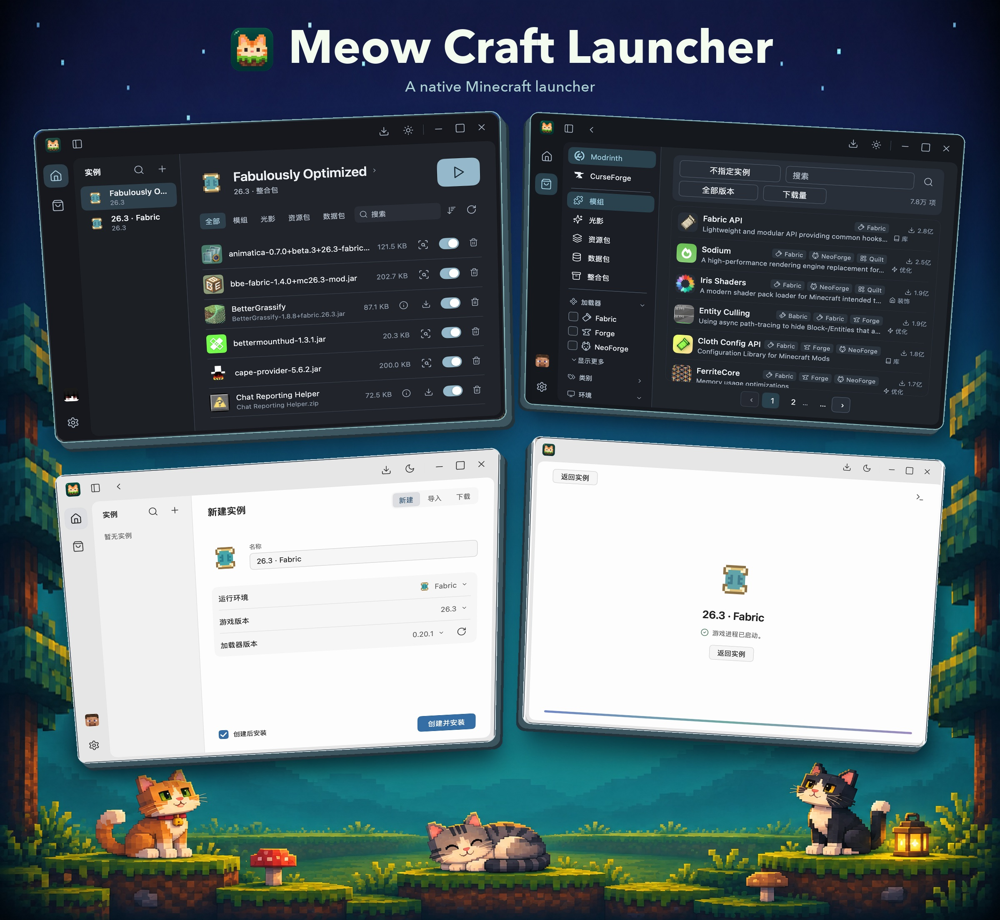

# Meow Craft Launcher

[English](README.md) · 简体中文

[](https://awesomemygo.dev/apps/meow-craft-launcher)



**mcl** 是用 Go 和 MyGo 开发的原生 Minecraft Java 版启动器。你可以在同一个应用里创建独立实例、浏览模组和资源包，以及管理 Java 运行环境。

## 本地开发

需要 Go 1.27.3 或更高版本。

```sh
go tool mygo dev
```

## 发版

修改 `mygo.json` 中的 `version` 并提交，然后推送对应版本标签。

```sh
git tag v0.0.1
git push origin main v0.0.1
```

CI 自动发布 macOS 通用 DMG（Apple Silicon 和 Intel）、Windows x64 安装包及 SHA-256 校验文件。Windows 文件名中的 `amd64` 表示 **x86-64／x64**，适用于 Intel 和 AMD 的 64 位 Windows，不是 ARM64，也不适用于 32 位 Windows（x86）。CI 会检查主程序和安装包内程序的真实 PE 架构及摘要，不只检查文件名。macOS 应用采用临时签名，Windows 安装包尚未签名。手动运行 **Desktop release** 可生成供下载的构建产物。

## 许可

mcl 采用 [MIT 许可证](LICENSE)。随包附带的第三方图标、字体和库沿用各自的许可证，声明保留在对应目录。
